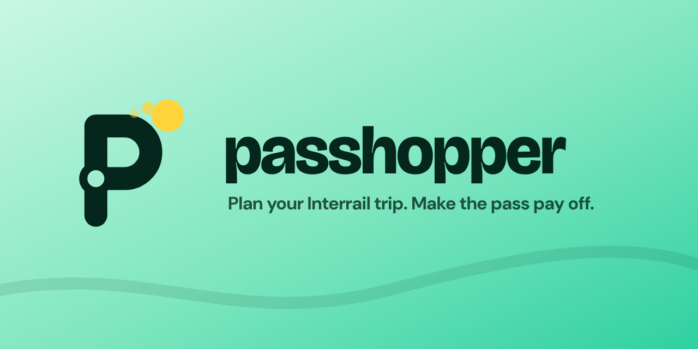
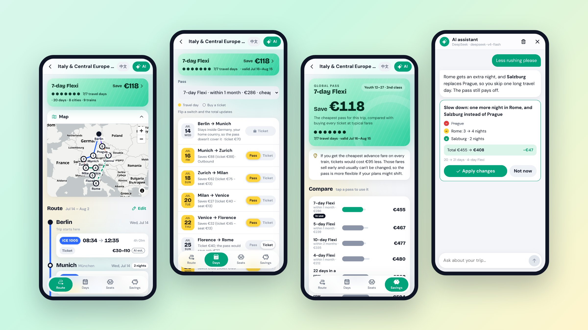
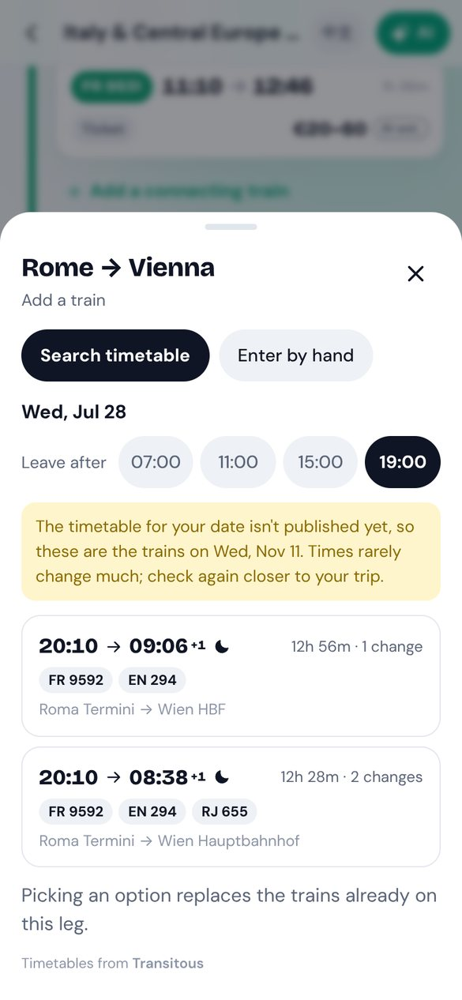
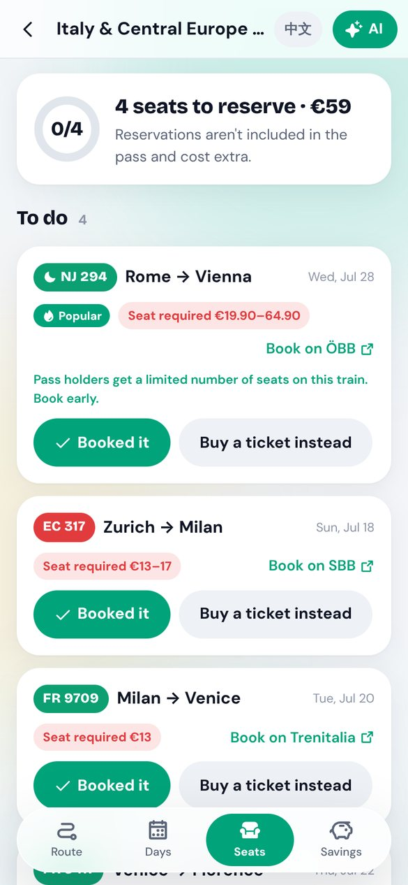
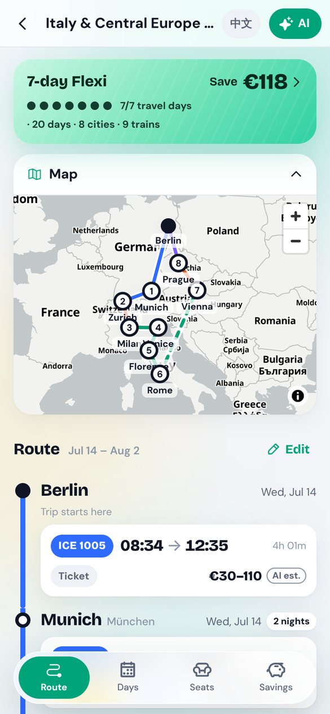

<p align="center"></p>

<p align="center">
  <a href="https://vittoriocai.github.io/Passhopper/"><b>Open the app →</b></a>
  &nbsp;·&nbsp;
  <a href="README.zh-CN.md">简体中文</a>
</p>

<p align="center">
  <a href="https://github.com/VittorioCai/Passhopper/actions/workflows/ci.yml"></a>
  <a href="LICENSE"></a>
  
</p>

**Passhopper is a free, open-source planner for Interrail passes.** Lay out your route, find real trains, see which days are worth spending a travel day on, keep track of seat reservations, and find out whether the pass actually beats buying tickets.

It runs entirely in your browser. No sign-up, no tracking, and your trips never leave your device.

<p align="center"></p>

## Why Passhopper

Most trip planners treat a rail pass like any other ticket. The questions that decide whether a pass is worth it are specific to it:

- **Which days should use the pass?** A Flexi pass has a fixed number of travel days. Passhopper picks the days that save the most, and you can flip any day between "pass" and "ticket" and watch the total update.
- **Does the pass even cover this train?** If you live in Europe, your pass covers only one journey out of your home country and one back in. A night train uses one travel day, but not on the pass's last valid day. Some operators aren't covered at all. These rules are built in.
- **What will the reservations cost?** High-speed and night trains often need a seat reservation on top of the pass. Fees come from the official Interrail fee pages, and the app tells you where to book and which trains sell out.
- **Is the pass actually cheaper?** The savings page compares every pass with buying all tickets, at cheap, typical and flexible fares. It tells you when cheap advance tickets would beat the pass, and which train's price decides the answer.

## Features

|                                |                                                                                                                                                                                                                                         |
| ------------------------------ | --------------------------------------------------------------------------------------------------------------------------------------------------------------------------------------------------------------------------------------- |
| 🗺️ **Route**                   | Metro-map timeline and a map of your trip. Nights per city, drag to reorder, night trains, notes for each city.                                                                                                                         |
| 🚆 **Real timetables**         | Search actual trains between your cities with [Transitous](https://transitous.org), an open-data journey planner. Covers high-speed, international and night trains.                                                                    |
| 📅 **Travel days**             | A calendar of your trip and the best days for your pass, worked out by the rules engine, with a switch on every day.                                                                                                                    |
| 💺 **Seat reservations**       | What needs a reservation and what it costs, a to-do list, and a place to note your booking and seat.                                                                                                                                    |
| 💶 **Savings**                 | Every pass compared with buying tickets, including the worst case and the most price-sensitive train. Totals can also show in your own currency.                                                                                        |
| ⚠️ **Checks**                  | Warnings for overlapping trains, tight changes, missed connections and very long days.                                                                                                                                                  |
| ✨ **AI assistant (optional)** | Describe a trip in one sentence and get a first route, or ask for changes ("slow down in Italy"). Every change is previewed with its cost before you apply it, and you can undo it. Searches the web for strikes and engineering works. |
| 📱 **Works like an app**       | Install it to your home screen, use it offline, light and dark themes. English and 简体中文. Share a trip as a link; the trip travels inside the link, not through a server.                                                            |

<table>
  <tr>
    <td></td>
    <td></td>
    <td></td>
  </tr>
  <tr>
    <td align="center">Real trains, including night trains</td>
    <td align="center">Reservations and where to book</td>
    <td align="center">Your route on a map</td>
  </tr>
</table>

## Privacy

- **Your trips stay on your device**, in your browser's storage. Export them to a file to back up or move to another device.
- **There is no Passhopper server.** The app is static files on GitHub Pages.
- **The AI assistant uses your own key** (DeepSeek, Claude, or any OpenAI-compatible provider). The key is stored only in your browser, optionally encrypted with a password, and sent only to the provider you pick, straight from your device. The assistant sees cities, dates, trains, your age group and class, and nothing else.
- Timetable searches go to Transitous, map tiles come from OpenFreeMap, and exchange rates (if you turn them on) come from the European Central Bank via Frankfurter.

## How accurate is it?

| Data                                    | Source                                                          | Status                                                       |
| --------------------------------------- | --------------------------------------------------------------- | ------------------------------------------------------------ |
| Seat reservation fees and pass coverage | interrail.com fee pages (domestic, international, night trains) | Checked 4 Nov 2026                                           |
| Home-country rule, night train rules    | interrail.com                                                   | Checked 4 Nov 2026                                           |
| Pass prices                             | Secondary sources                                               | **Estimates.** Check interrail.com before buying.            |
| Timetables                              | Transitous (open data from the operators)                       | Live. Dates more than a few months ahead show a sample week. |
| Ticket prices for comparison            | You, or an AI estimate                                          | Marked by source on every train                              |

Every rule and its source is listed in [`docs/RULES-AND-SOURCES.md`](docs/RULES-AND-SOURCES.md) (in Chinese). Found something wrong? [Open an issue](https://github.com/VittorioCai/Passhopper/issues). Corrections to rules and fees are the most useful contribution there is.

## Development

Requires Node 22 and pnpm 10.

```bash
pnpm install
pnpm dev          # dev server at http://localhost:5173
pnpm test         # unit and UI tests (Vitest + Testing Library)
pnpm lint && pnpm typecheck
pnpm build        # production build with offline support
```

**Stack:** React 19, TypeScript, Vite, React Router, Dexie (IndexedDB), zod, i18next, MapLibre GL with OpenFreeMap tiles, the official Anthropic SDK for Claude, and plain `fetch` for OpenAI-compatible providers. Styling is CSS Modules with design tokens. Icons are Phosphor.

```
app/src/
  engine/     rules engine: coverage, home-country rule, travel days, optimizer, checks
  data/       passes, reservation rules, cities and stations
  ai/         assistant: providers, tools, plan patches
  timetable/  Transitous search
  pages/      Route, Travel days, Seats, Savings, New trip, Settings
docs/         product, rules and UI design docs (Chinese)
```

## Roadmap

- [x] Route planning, travel-day optimizer, seat reservations, savings
- [x] Official reservation fees, home-country and night train rules
- [x] AI assistant with your own key
- [x] Real timetables, route map, conflict checks
- [x] City notes, train check links, one-tap AI prices, trip calendar, drag to reorder
- [x] Currency hints, password-protected AI keys, share links
- [ ] Verified pass prices
- [ ] Reservation reminders
- [ ] More languages

## Contributing

Issues and pull requests are welcome. Good places to start:

- Report a wrong fee, rule or train type (please include a link to the source)
- Add a city's main station to `app/src/data/stations.ts`
- Translate the app (`app/src/i18n/`)

Please run `pnpm lint && pnpm typecheck && pnpm test` before opening a pull request.

## License

[MIT](LICENSE)

_Passhopper is an independent project and is not affiliated with Interrail / Eurail B.V. "Interrail" and "Eurail" are trademarks of Eurail B.V. Rules and prices are for guidance only. Always check the official sources before you travel._
