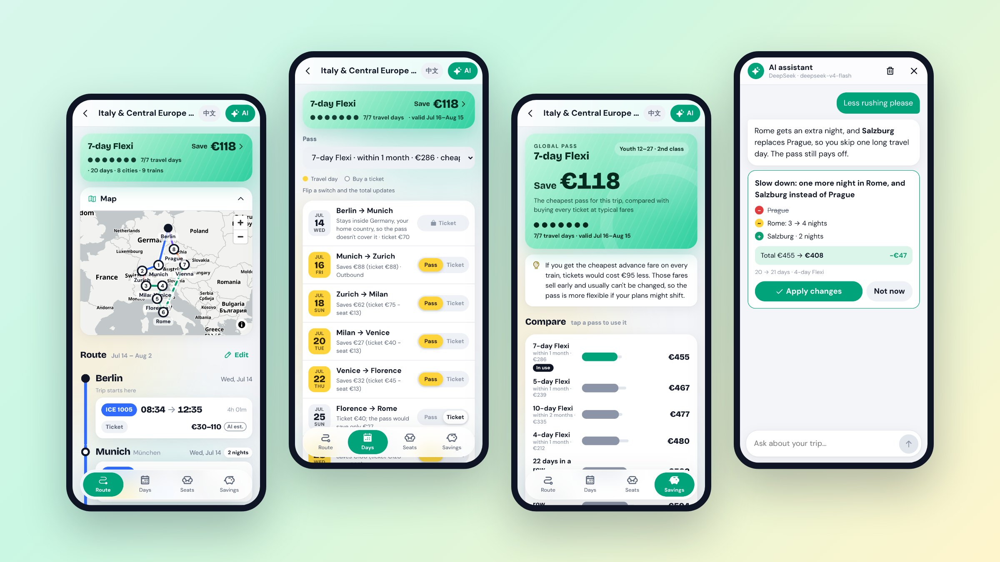

<p align="center"></p>

<p align="center">
  <a href="https://vittoriocai.github.io/Passhopper/"><b>打开网页版 →</b></a>
  &nbsp;·&nbsp;
  <a href="README.md">English</a>
</p>

**Passhopper（通票漫游）是一个免费、开源的 Interrail 通票行程规划工具。** 排路线、查真实车次、决定哪天用旅行日、管理订座，并算清楚买通票到底划不划算。

全部在浏览器里运行：不用注册，没有追踪，行程只保存在你自己的设备上。网页右上角可以切换中文。

<p align="center"></p>

## 为什么做这个

普通的行程工具把通票当成普通车票。可决定通票值不值的，恰恰是通票特有的规则：

- **哪几天用通票？** Flexi 通票的旅行日有限。Passhopper 会挑出最省钱的几天，每一天都可以手动切换"通票"或"买票"，总价实时更新。
- **这趟车通票能用吗？** 欧洲居民在居住国只能出境、入境各用一次；夜车只算出发当天，但有效期最后一天不能坐夜车回家；有些运营商根本不收通票。这些规则都已内置。
- **订座要花多少钱？** 高铁和夜车常常要另付订座费。费用取自 Interrail 官网的订座费页面，还会告诉你去哪订、哪些车容易订满。
- **通票真的更便宜吗？** 回本页把每种通票和全部单独买票做对比，按特价、常见、灵活三档票价分别计算，并告诉你哪一段票价最影响结论。

## 功能

|                        |                                                                                                                                                 |
| ---------------------- | ----------------------------------------------------------------------------------------------------------------------------------------------- |
| 🧭 **路线推荐**        | 10 条现成路线（经典阿姆斯特丹到布达佩斯、意大利、阿尔卑斯、北欧、巴尔干等），写明每个城市玩什么、坐车要注意什么，可以照着用，也可以当起点修改。 |
| 🗺️ **路线**            | 地铁线路图式的时间线，加上路线地图。每个城市住几晚、拖动调整顺序、夜车、城市备注。                                                              |
| 🚆 **真实时刻表**      | 用开源数据的 [Transitous](https://transitous.org) 查询城市之间的真实车次，也可以一键给整趟行程的每一段配好车次，包括高铁、跨国列车和夜车。      |
| 📅 **旅行日**          | 行程日历，加上规则引擎算出的最划算旅行日，每天都能手动切换。不填票价也能用：长途的日子优先用旅行日。                                            |
| 💺 **订座**            | 哪些车要订座、要多少钱，待办清单，记录订座号和座位。                                                                                            |
| 💶 **回本**            | 每种通票与全部买票的对比，包括最坏情况和最影响结论的车次。总价可同时显示你的本国货币。                                                          |
| ⚠️ **检查**            | 车次时间重叠、换乘太紧、赶不上下一班车、一天坐车太久时给出提示。                                                                                |
| ✨ **AI 助手（可选）** | 一句话生成第一版路线，或者让它改行程（"意大利那段别太赶"）。每次改动都先预览费用变化，确认后才应用，并且可以撤销。还能联网查罢工和施工信息。    |
| 📱 **像 App 一样用**   | 可添加到手机主屏幕，离线可用，浅色和深色主题，English 和简体中文。可以用链接分享行程，行程数据就在链接里，不经过服务器。                        |

## 隐私

- **行程只保存在你的设备上**（浏览器存储）。可以导出成文件备份，或者转到另一台设备。
- **Passhopper 没有服务器**，整个应用是放在 GitHub Pages 上的静态网页。
- **AI 助手使用你自己的 key**（DeepSeek、Claude 或任何兼容 OpenAI 格式的服务）。key 只保存在你的浏览器里（可选用密码加密），只从你的设备直接发给你选的服务商。AI 只能看到城市、日期、车次、年龄段和舱等。
- 分享链接里的行程数据在 `#` 之后，浏览器不会把这部分发给服务器；订座号和座位不会包含在内。
- 时刻表查询发给 Transitous，地图底图来自 OpenFreeMap，汇率（开启后）来自欧洲央行（经 Frankfurter）。

## 数据准确吗？

| 数据                 | 来源                                         | 状态                                                 |
| -------------------- | -------------------------------------------- | ---------------------------------------------------- |
| 订座费和通票适用范围 | Interrail 官网订座费页面（国内、国际、夜车） | 2026-11-04 已核实                                    |
| 居住国规则、夜车规则 | Interrail 官网                               | 2026-11-04 已核实                                    |
| 通票价格             | 第三方来源                                   | **估计值**，购买前请以官网为准                       |
| 时刻表               | Transitous（各运营商公开数据）               | 实时查询；几个月以后的日期会显示近期同一星期几的车次 |
| 用于对比的单程票价   | 你自己填写，或 AI 估算                       | 每趟车都标明来源                                     |

每条规则的来源见 [`docs/RULES-AND-SOURCES.md`](docs/RULES-AND-SOURCES.md)。发现错误欢迎[提 issue](https://github.com/VittorioCai/Passhopper/issues)，纠正规则和费用是最有用的贡献。

## 本地开发

需要 Node 22 和 pnpm 10。

```bash
pnpm install
pnpm dev          # 开发服务器 http://localhost:5173
pnpm test         # 单元测试和界面测试
pnpm lint && pnpm typecheck
pnpm build        # 生产构建，支持离线
```

技术栈、目录结构和路线图见 [英文 README](README.md#development)，产品和设计文档在 [`docs/`](docs/README.md)。

## 许可证

[MIT](LICENSE)

_Passhopper 是独立项目，与 Interrail / Eurail B.V. 无关联。"Interrail" 和 "Eurail" 是 Eurail B.V. 的商标。规则和价格仅供参考，出行前请以官方信息为准。_
