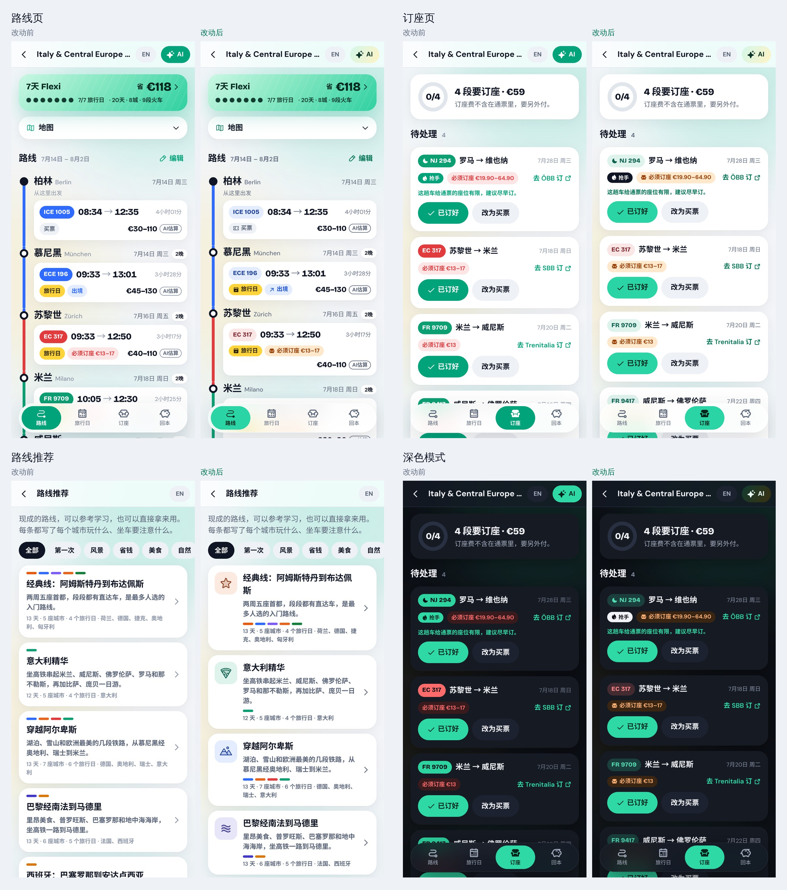
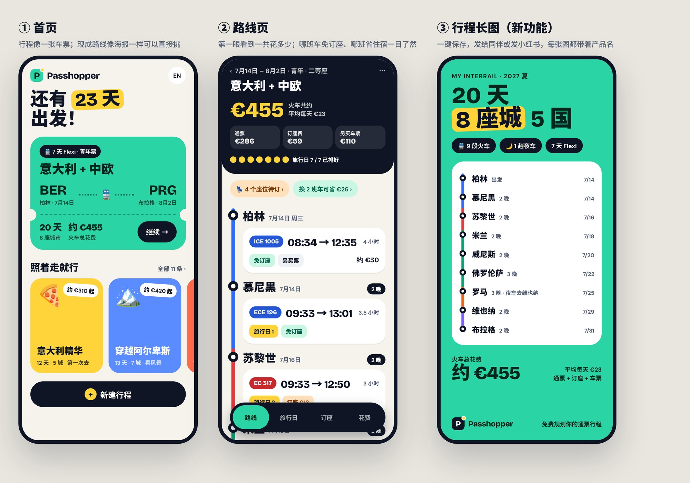

# Passhopper UI 优化方案

版本 v1.2 · 2026-11-15

- v1.1：新增第 4 节"色彩与图标"，并按它更新了 3.1、3.2 的色值；这部分已在 `ui-refresh` 分支做出来，见第 4 节的对比图。
- v1.2：明确目标用户是 20–30 岁、预算有限的旅行者（第 2 节），据此改了 5.2（通票卡显示什么）、降低了桌面端的优先级，并新增 5.8–5.10。

本文是对线上版本的一次完整界面走查，以及按优先级排好的优化方案。评估依据：

- **走查范围**：首页、新建向导 3 步、路线页（含编辑模式）、车次窗口、旅行日、订座、回本、设置、路线推荐、AI 助手、行程单；手机宽度（390 px）和桌面宽度（1440 px），浅色和深色。
- **评估标准**：产品定位（"让旅客规划行程更便捷，回本是添头"；目标用户见第 1a 节）、信息层级、一致性、可读性（WCAG 2.1 AA 对比度）、触控尺寸（44 px）、操作步数。
- **对比度数字**是按 `app/src/styles/tokens.css` 的实际色值算出来的，不是目测。

---

## 1. 结论

整体视觉已经有辨识度：地铁线路图式的时间线、钱包式通票卡、薄荷绿配柠檬黄，深色模式也完整。问题不在"好不好看"，而在三件事：

1. **看不清**：正文辅助色和主色按钮的对比度不达标，小字偏多。
2. **颜色的含义打架**：绿色同时表示"主操作""意大利线路""成功""通票有效期"；红色用在并非错误的"必须订座"上，整页显得在报警。
3. **操作分散、编辑模式偏重**：行程的常用操作散落在四个地方；路线编辑要先切换模式，一行出现 5 个控件。

另外，桌面端目前只是"放大的手机版"，两侧大面积空白没有利用。

按性价比排序，建议先做 **P0 的 6 项**（约 2–3 天工作量），它们几乎不改结构，但对可读性和专业感提升最大。

---

## 1a. 目标用户：20–30 岁，预算有限

主要用户是学生、留学生和刚工作的年轻人，多数是第一次用 Interrail，用青年票（12–27 岁），住青旅，和朋友一起走，几乎只用手机。这改变了几项判断：

| 判断 | 原来 | 现在 |
|---|---|---|
| 钱在界面上的位置 | "回本是添头"，把金额降下去 | 这群人对钱最敏感，金额要留在显眼处。但要换一个数字：他们想知道的是**这趟火车一共花多少**，而不是"比单独买票省多少"（见 5.2） |
| 订座费 | 一项待办 | 一项可以省掉的开支。要让人一眼看出哪些车不用订座、换一班车能省多少（见 5.8） |
| 桌面端双栏 | 第 4 批 | 降到最后。这群人在手机上规划，桌面端保持能用即可 |
| 路线推荐 | 首页的次要入口 | 首页的主要入口，并标出每条路线的大致花费。第一次用的人需要一个现成的起点 |
| 术语 | 默认用户懂"旅行日""Flexi""订座" | 多数人不懂。这些词第一次出现时要能点开看一句解释（见 5.9） |
| 分享 | 有链接分享 | 这群人会把行程发给同伴、发到小红书和 Instagram。一张可以保存的行程长图比链接更有用，也是最直接的传播方式（见 5.10） |
| 视觉气质 | 清晰、专业 | 在清晰的前提下可以更活泼：第 4 节的亮薄荷绿、图标块就是这个方向 |
| 打印、密码保护 key | 已有功能 | 保留，但不再占用显眼位置 |

---

## 2. 做得好、应当保留的

| 设计 | 为什么保留 |
|---|---|
| 地铁线路图式时间线，按国家着色 | 这是产品最有记忆点的视觉，一眼看懂路线和跨国 |
| 钱包式通票卡 + 旅行日圆点 | 把抽象的"旅行日额度"变成看得见的东西 |
| 旅行日用黄色，全站只在这一个含义上使用 | 黄色语义干净，应作为范例推广到其他颜色 |
| 底部悬浮胶囊标签栏 | 拇指可达，辨识度高 |
| AI 改动预览卡（增、删、改 + 费用变化 + 可撤销） | 让人敢用 AI，这是信任设计 |
| 深色模式 | 完整且协调，主色按钮在深色下对比度 8.9:1 |
| 首页"下一趟车"深色卡片 | 层级清楚，路上一眼可读 |

---

## 3. P0：先做，改动小、收益大

### 3.1 对比度不达标（影响所有页面）

**现状（实测）**

| 用途 | 色值 | 对比度 | AA 要求 |
|---|---|---|---|
| 辅助文字 `--ink-3`（日期、车程、站名原文、图例）在页面底色上 | #8C95A7 / #F3F5F8 | **2.76** | 4.5 |
| 同上，在白色卡片上 | #8C95A7 / #FFFFFF | **3.01** | 4.5 |
| 主按钮白字在主色上 | #FFFFFF / #00A37A | **3.22** | 4.5 |
| 主色文字链接（"编辑""去 ÖBB 订"）在底色上 | #00A37A / #F3F5F8 | **2.95** | 4.5 |
| "必须订座"红字在浅红底上 | #E23B3E / #FDE5E5 | **3.55** | 4.5 |
| "出境 / 入境"蓝字在浅蓝底上 | #2F6BFF / #E4ECFF | **3.80** | 4.5 |
| 车次胶囊白字：意大利线 / 奥地利线 | #0C9F72、#E8641C | **3.38 / 3.35** | 4.5 |
| 深色模式辅助文字在卡片上 | #6E7789 / #151A23 | **3.87** | 4.5 |

在户外强光下看手机，正是这个产品的典型使用场景，这些文字会更难读。

**方案**：只改设计令牌，组件不动。

| 令牌 | 现在 | 改为 | 改后对比度 |
|---|---|---|---|
| `--ink-3`（浅色） | #8C95A7 | #646E82 | 4.70（底色）/ 5.13（白卡片）/ 4.53（灰底输入框） |
| `--primary`（按钮填充） | #00A37A + 白字 | **#2BD4A4 + 深绿字 #04261C** | 8.51 |
| 新增 `--primary-text`（绿色文字、链接、描边） | — | #007556 | 5.23（底色）/ 5.71（白卡片）/ 5.02（浅绿底） |
| `--danger` | #E23B3E | #B42326 | 5.53（浅红底）/ 6.54（白卡片） |
| `--blue` | #2F6BFF | #1F55D6 | 5.33（浅蓝底） |
| 新增 `--amber` / `--amber-soft` | — | #9A3F00 / #FFE8CC | 5.73 |
| `--sun-text` | #8A6A00 | #7A5C00 | 5.71（浅黄底） |
| `--ink-3`（深色） | #6E7789 | #8891A4 | 5.51（卡片）/ 5.02（次级底色） |

主按钮没有采用"把绿色调深"的做法（v1.0 的方案）。调深以后和普通的企业绿没有区别，也和通票卡的亮薄荷绿脱节。改为**亮薄荷绿底配深绿字**：对比度从 3.22 提到 8.51，颜色更有辨识度，并且和深色模式的按钮一致（深色模式本来就是这样做的）。车次胶囊见 3.2，完整色彩体系见第 4 节。

### 3.2 颜色含义冲突

**现状**
- 绿色有 4 个含义：主操作按钮、意大利线路色、"已订 / 最省"成功状态、通票有效期下划线。订座页里一张意大利车次的卡片上，车次胶囊、"抢手"标签、订票链接、提示文字、"已订好"按钮全是绿色，分不出主次。
- "必须订座 €13"用错误红。它是待办，不是出错。路线页一屏里有三四个红色标签，观感像"到处有问题"。真正的冲突提示反而用的是黄色。

**方案：给每种颜色只留一个含义**

| 颜色 | 唯一含义 |
|---|---|
| 亮薄荷绿（实心） | 可以点的主操作、当前所在的标签页 |
| 柠檬黄（实心） | 旅行日（已如此，保持） |
| 琥珀（浅底深字） | 需要你做点什么：必须订座 |
| 浅黄（浅底深字） | 建议但不强制：建议订座、需核实 |
| 蓝（浅底深字） | 中性信息：出境、入境 |
| 红 | 只用于错误和冲突：车次时间重叠、通票不适用、删除 |
| 国家线路色 | 时间线竖线用实色；车次胶囊和国家代码用同一颜色的浅底深字 |
| 薄荷绿到柠檬黄的渐变 | AI（按钮、一句话生成路线的输入框） |

具体改动：
1. **车次胶囊改为"线路色浅底 + 线路色深字"**，不再用线路色实心填充。时间线竖线仍是实色，所以国家的辨识度还在，但意大利车次不再像一个绿色按钮。25 个国家的胶囊对比度全部 ≥ 6.3（浅色）/ 5.1（深色），原来意大利、奥地利只有 3.4。
2. "必须订座"标签改为琥珀色并加座位图标；"通票不适用"保留红色。
3. 冲突提示（时间重叠、赶不上车）从黄色改为红色描边，和"待办"区分开。（未做）
4. "抢手"标签改为墨色底加火焰图标，不再用主色绿。

### 3.3 主按钮样式不统一

**现状**：新建向导的"下一步 / 创建行程"是黑色胶囊，其他页面的主按钮是绿色；分段选择的选中态也是黑色。同一屏里"黑色 = 选中"和"黑色 = 主操作"混在一起。

**方案**：绿色实心 = 主操作（全站唯一）；墨色 = 选中状态；灰底 = 次要操作。向导的"下一步"改成绿色。

### 3.4 时间输入显示成 12 小时制

**现状**：英文界面下，车次窗口的时间输入框显示 "10:05 AM / 12:30 PM"，而页面其他地方全是 24 小时制。欧洲铁路只用 24 小时制，这里容易填错。

**方案**：时间输入改用自带的 24 小时输入（两段数字输入或带格式校验的文本框，数字键盘），不依赖浏览器按系统语言决定的显示方式。同时把"第二天到达""午夜后出发"两个复选框合并成到达时间旁的一个"+1 天"小开关，现在两句话读起来费劲。

### 3.5 顶栏：行程名被挤掉，操作找不到

**现状**
- 手机上行程名显示为 "Italy & Central Europe …"，因为右侧放了语言按钮和 AI 按钮。语言是一次性设置，不需要每页常驻。
- 行程的常用操作分散在四处：分享和复制在首页卡片的"⋯"里；导入日历和打印在路线页最底部；改名、改日期、改旅客信息藏在"编辑"模式里；删除又在首页。用户很难发现"导入日历"。

**方案**
1. 行程页顶栏去掉语言按钮（首页和设置保留）。
2. 顶栏右侧加一个"⋯"行程菜单，集中放：行程设置（名称、日期、居住地、年龄段、舱等）、分享链接、导入日历、打印 / PDF、复制行程、删除行程。
3. 路线页底部那排按钮和首页卡片菜单随之简化。

### 3.6 桌面端日历错位

**现状**：1440 px 宽度下，旅行日日历的星期标题在每列居中，日期格子却靠左，两者对不上（格子被限制了最大高度，宽度没跟上）。

**方案**：格子在列内居中，或改为固定高度、宽度撑满。属于缺陷，一并修掉。

---

## 4. 色彩与图标

v1.0 只解决了"看不清"和"含义冲突"。这一节解决"好不好看、成不成体系"。标注"已做"的部分在 `ui-refresh` 分支上，改动前后对比：

### 4.1 色彩：三种品牌色，各管一件事

现在的问题是颜色多而且都很饱和：一屏里同时有绿按钮、蓝红绿橙紫的实心车次胶囊、黄标签、红标签，没有主次。

原则是**大面积用中性色，饱和色只留给三处**：

| 角色 | 颜色 | 用在哪 |
|---|---|---|
| 品牌主色 | 亮薄荷绿 #2BD4A4（上面的字用深绿 #04261C） | 主按钮、当前标签页、通票卡 |
| 品牌强调色 | 柠檬黄 #FFD43B | 旅行日，全站只此一处 |
| 底色 | 墨色 #0F1524 | 标题、选中状态、总价条、"下一趟车"卡片 |

其余颜色全部降为**浅底深字**（底色取该颜色的 13%，文字取该颜色加深 45%），包括车次胶囊、状态标签、国家代码、路线推荐的图标块。这样彩色仍然在，但不再和主按钮抢视线；深色模式用同一套规则反过来算（底色 20%，文字提亮）。

国家线路色的 25 种色值不用逐个重调：胶囊的底色和文字用 CSS `color-mix()` 从线路色自动算出，以后新增国家也不用单独配色。

**AI 有自己的颜色**（已做）：AI 按钮和"一句话生成路线"输入框用薄荷绿到柠檬黄的浅渐变。原来 AI 按钮和主按钮同色，顶栏里它比页面上真正的主操作还醒目。

### 4.2 图标：粗细规则，以及颜色之外的第二种信号

图标库保持 Phosphor，不换。现在的问题是用法没有规则：细线、粗线、填充、双色四种粗细混用，状态标签全靠颜色区分。

**粗细规则**

| 场景 | 粗细 | 例子 |
|---|---|---|
| 界面里的小图标（≤ 20 px）：按钮、标签、链接 | bold | 编辑、加号、外链箭头 |
| 表示"当前 / 已发生"的状态 | fill | 当前标签页、夜车月亮、必须订座 |
| 装饰性的大图标（≥ 18 px），放在浅色圆角块或提示条里 | duotone | 路线推荐图标块、空状态、AI 介绍 |
| 默认的细线 regular | 不使用 | — |

已按这个规则改掉 2 处不一致（备注小图标、密码显示按钮）。

**状态标签都带图标**（已做）。颜色不是唯一信号，色弱用户和强光下也能分清：

| 标签 | 图标 |
|---|---|
| 旅行日 | 打勾的日历 |
| 买票 | 车票 |
| 必须订座 / 建议订座 | 座椅（实心 / 线条） |
| 出境 / 入境 | 右上箭头 / 左下箭头 |
| 通票不适用 | 禁止 |
| 需核实 | 问号 |

**路线推荐的图标块**（已做）。11 条路线各有一个图标（经典线是星星，意大利是披萨，阿尔卑斯是雪山，挪威是雪花，巴尔干是桥，荷比卢是自行车……），放在该路线第一个国家颜色的浅色块里。列表原来只有文字，现在每条路线有了可以记住的样子。

### 4.3 还没做、建议接着做的

| 项 | 说明 |
|---|---|
| 首页行程卡片 | 三个数字块（出发日、城市数、车次数）各加一个小图标；"路线推荐"按钮换成带图标块的横向卡片（和 5.5 一起做） |
| 标签栏第四项 | 小猪存钱罐图标保留，对预算有限的用户它正合适；标签名从"回本"改为"花费"（见第 6 节） |
| 回本页对比条 | 非当前方案的灰色条偏重，改成更浅的灰，让当前方案更突出 |
| 应用图标和 logo | logo 的绿是 #00A37A，比新的按钮色深一档。两者并排不冲突，但严格来说应统一。改 logo 要重新导出图标、横幅和 README 图，建议单独做 |
| 空状态 | 现在是图标块加文字，可以换成一张简单的线路图插画（用现有的线路色） |
| 国旗 | 不建议用国旗 emoji：Windows 上不显示国旗，只显示两个字母 |

### 4.5 更年轻的方向稿（待确认）

第 4.1–4.2 节的改动让界面更干净，但没有解决另一个问题：现在的界面像理财或效率工具，对 20–30 岁的用户缺少旅行的兴奋感，也没有值得截图发出去的画面。下面是一版方向稿（静态示意，源文件在 `design/mockups/young-direction.html`；图里的路线起价、"换车可省"等数字是示意）：

和现在相比，变的是这几件事：

| | 现在 | 方向稿 |
|---|---|---|
| 底色 | 冷灰底 + 白卡片 | 暖米色底 + 整块的品牌色（薄荷绿、墨色、柠檬黄） |
| 首页主角 | 一张信息卡片 | 一张"车票"：出发和到达城市的大字缩写、倒计时、总花费 |
| 路线推荐 | 灰色次要按钮，点进去是文字列表 | 首页的彩色海报卡片，带起价，可以横滑 |
| 路线页顶部 | 通票卡 + "省 €118" | 墨色大块：火车总花费、三项拆分、旅行日进度 |
| 车次胶囊 | 浅色（4.1 的改动） | 改回实心，但用加深过、对比度达标的线路色 |
| 标签 | 小号浅色标签 | 贴纸式的方角标签："旅行日 1""免订座""订座 €13" |
| 标签栏 | 半透明白色 | 墨色实心，当前页用薄荷绿 |
| 字 | 标题 28–32 px | 标题 40 px 以上，数字用展示字体放大 |

不变的：线路图式时间线、薄荷绿和柠檬黄、Phosphor 图标、所有功能和页面结构。

风险：色块和大字占空间，一屏能看到的车次会从约 3.5 段减到约 3 段；需要重新截 README 和推广用的图。

### 4.4 取舍

- **主色没有调深，而是换了字的颜色。** 调深最省事，但会丢掉"薄荷汽水"的清爽感。代价是亮绿按钮在浅灰背景上的边界对比度只有约 1.9:1。按钮靠文字识别，这不违反对比度标准，但按钮本身不如深绿醒目。
- **车次胶囊从实心改成浅色。** 实心胶囊更像真实的地铁线路牌，但一屏有 5 种国家色时太吵。竖线保留了实色，线路图的感觉还在。如果更喜欢实心，可以只把对比度不够的几个国家色调深，保留实心。
- **状态标签加图标后变宽了**，中文界面里"旅行日 + 必须订座 + 票价"有时会从一行变成两行（英文界面原来就会换行）。

---

## 5. P1：结构性优化，各需半天到一天

### 5.1 路线页取消"编辑模式"，改为点城市直接编辑

**现状**：要先点右上角不起眼的"编辑"文字，页面顶部展开一张 5 个字段的表单，每个城市下再出现"添加备注 + 晚数加减 + 拖动 + 上移 + 下移 + 删除"。模式切换本身就是负担，一行 5 个控件也很挤。删除城市没有确认，连带的车次直接消失。

**方案**
- 点城市名 → 弹出**城市面板**：晚数、备注、"移到…"、删除。
- 拖动排序改为长按城市行直接拖，去掉常驻的上移 / 下移按钮（键盘用户仍可在面板里用"移到…"）。
- 行程级字段移到 3.5 的"行程设置"里。
- **所有删除操作统一给"已删除 · 撤销"提示条**（现在只有 AI 改动能撤销），替代确认弹窗。

### 5.2 路线页首屏：把"省多少"换成"一共花多少"

**现状**：路线页第一眼是通票卡上的"省 €118"。这个数字是"比全部单独买票便宜多少"，依赖用户填的票价，是全站最不可靠的数字；而预算有限的用户真正要做预算的数字（这趟火车一共花多少）要点进第四个标签才看得到。

**方案**：通票卡的主数字改为**"火车共约 €455"**（通票 + 订座费 + 另买的车票），下面一行小字拆开："通票 €286 · 订座 €59 · 车票 €110"，人数多于 1 时再显示人均。左侧保留通票类型和旅行日圆点。卡片下方一行显示下一步该做什么（"还有 3 段没车次""4 个座位待订"）。"比买票省 €118"缩成小字，只在填了票价后出现。

通票价格目前是估计值，所以金额前加"约"，并沿用现有的"价格为估计"提示。

### 5.3 新建向导第 2 步：先做正事

**现状**：标题下面先是两行提示（路线推荐链接、"想用一句话描述？先添加 AI key"），然后才是"从哪里出发"。对没有 AI key 的大多数人，第二行是纯干扰。城市行里同样是"拖动 + 序号 + 上移 + 下移 + 删除"5 个控件。

**方案**
- 没有 AI key 时不显示 AI 提示；有 key 时才显示输入框。
- "路线推荐"入口改成搜索框下方的一行横向可滑动的小卡片（3–4 条热门路线），比文字链接更容易被看到。
- 城市行精简为"拖动手柄 + 名称 + 删除"。
- "上一步 / 下一步"固定在屏幕底部，城市多了也不用滚到底。

### 5.4 底部面板：操作按钮固定在底部

**现状**：车次窗口内容很长（车次、车站、时间、票价、AI 估价、核实链接），"保存"在最下面，要滚动才看得到；"删除这趟车"还在更下面。

**方案**：面板底部固定操作栏（保存 / 取消），内容区单独滚动。"核实这趟车"的链接折叠成一行"核实车次 ›"。删除放到面板右上角的"⋯"里。一键找车面板同样处理。

### 5.5 首页：给新用户一个更明确的起点

**现状**：第一次打开，只有一张示例行程和两个按钮，"路线推荐"是灰色的次要按钮。它其实是新用户最好的入口。行程卡片里日期、城市数、火车数三个大方块占了卡片一半高度，行程多了以后列表很长。

**方案**
- 首页加一行"路线灵感"横向卡片（每张：路线名、天数、国家色条），放在行程列表下方；没有自己的行程时放在最上面。
- 行程卡片的三个方块压缩成一行小字（"7 月 14 日 · 20 天 · 8 城 · 9 段车"），卡片高度减少约三分之一。
- 桌面端首页左侧导航和顶栏各有一个 logo，去掉顶栏那个。

### 5.6 桌面端：用上两侧的空间（优先级已降低，见第 1a 节）

**现状**：≥1024 px 时内容仍是 648 px 的单列，左右各有约 400 px 空白；地图挤在这一列的顶部，高度只有 340 px。

**方案**（≥1200 px）
- **路线页**：左列时间线，右列地图固定不动、撑满高度；鼠标移到城市上时地图高亮对应的点。
- **旅行日页**：左列日历固定，右列逐日列表。
- **首页**：行程卡片两列排布。
- AI 面板打开时占用右列，不再盖住内容。

### 5.7 设置页

**现状**："获取 Claude API key"是灰色文字，看不出是链接；AI 设置（服务商、key、模型、测试、密码保护、说明）全堆在一张长卡片里；"清除所有 key"的红色文字紧挨着"测试连接"。

**方案**：链接用主色加外链图标；AI 设置拆成独立子页面，设置首页只显示一行"AI 助手 · 未设置 / DeepSeek ›"；危险操作与常用操作分开，放在子页面底部。

### 5.8 让省钱的选择看得见

**现状**：订座费只在"必须订座 €13"这种标签里出现，像是通知。用户不知道同一段路常常有不用订座的车。

**方案**
- 查车次的结果里，每个选项标出"免订座"（绿色）或"订座 €13"（琥珀色），并提供"只看免订座"的开关。数据已有：订座规则按车种判断。
- 一键找车增加"尽量免订座"选项，在车程增加不多时优先选不用订座的车。
- 夜车标签旁加一句"省一晚住宿"。
- 订座页顶部的汇总从"4 段要订座 · €59"扩成"其中 2 段可以换成免订座的车，能省 €26"，点开直接换车。
- 路线推荐的每张卡片标出"青年二等座约 €xxx 起"（通票 + 订座费）。

### 5.9 第一次用也看得懂

- "旅行日""Flexi 通票""订座""出境 / 入境"这些词第一次出现时带虚线下划线，点一下弹出一句话解释。
- 新建向导第 1 步的年龄段默认"青年 12–27"（已如此），并注明青年票比成人票便宜约四分之一。
- 首页没有行程时，直接展示 3 条路线推荐和"从这条开始"按钮，而不是空状态。

### 5.10 行程长图

在行程菜单里加"保存为图片"：生成一张竖版长图，内容是路线名、线路图式的城市串、每段车次和日期、总天数和火车总花费，底部带 Passhopper 的名字和网址。不含订座号和座位。图片在浏览器里本地生成，不经过服务器。

这是面向这群用户最直接的传播方式：发到小红书或发给同伴的每一张图都带着产品名。

---

## 6. P2：锦上添花

| 项 | 说明 |
|---|---|
| 触控尺寸 | 图标按钮现为 40–42 px，统一到 44 px；"去 ÖBB 订"这类文字链接加大点击区域 |
| 小字 | 样式里有 16 处 11 px 及以下的字号（图例、标签、日期块），最小统一到 12 px，中文界面到 13 px |
| 加载状态 | 查时刻表时用骨架屏占位，替代"正在查车次…"文字，减少跳动 |
| 保存反馈 | 改晚数、切换旅行日后没有任何反馈；加一个极轻的"已保存"提示或数字过渡动画 |
| 日历编码 | 一个格子上同时有黄色填充、描边、绿色下划线、月亮四种标记；有效期改为整段浅色背景带，减少一种编码 |
| 中文排版 | 标题字体的中文回退字重偏细，和英文粗标题不协调；中文界面标题改用 Noto Sans SC 900 字重，行高加到 1.3 |
| 订座卡片 | "已订好"和"改为买票"两个按钮同样大；后者改成文字按钮 |
| 标签栏 | 第四个标签"回本"改名"花费"，页面内容按"一共花多少 → 钱花在哪 → 选哪种通票最省"组织，和目标用户关心的顺序一致 |
| 首次引导 | 第一次进入行程页时，用 3 个轻提示点出"一键找车""旅行日""AI" |
| 动效 | 城市拖动结束、应用 AI 改动时加 200 ms 的位置过渡；尊重系统的"减少动态效果"设置（已部分支持） |

---

## 7. 建议的实施顺序

| 批次 | 内容 | 预计 |
|---|---|---|
| 第 1 批 | 3.1 对比度令牌、3.2 颜色语义和车次胶囊、3.3 主按钮统一、第 4 节色彩与图标（以上已在 `ui-refresh` 分支完成）；3.6 日历错位、冲突提示改红（未做） | 剩余半天 |
| 第 2 批 | 3.4 时间输入、3.5 顶栏和行程菜单、5.4 面板固定操作栏 | 1–1.5 天 |
| 第 3 批 | 5.2 通票卡显示总花费、5.8 让省钱的选择看得见、5.5 首页放路线推荐 | 2 天 |
| 第 4 批 | 5.1 城市面板和撤销、5.3 向导、5.9 术语解释 | 2 天 |
| 第 5 批 | 5.10 行程长图 | 1–1.5 天 |
| 第 6 批 | 5.7 设置页、5.6 桌面双栏、P2 各项，按反馈挑着做 | 按需 |

每批完成后同步更新 `docs/UI-DESIGN.md` 里的令牌和组件说明，并重新截 README 的图。

## 8. 验收标准

- 所有文字与背景的对比度 ≥ 4.5:1（大号粗体标题 ≥ 3:1），浅色和深色各测一遍，测试脚本纳入 CI。
- 一屏之内，实心绿色只出现在可点击的主操作上。
- 路线页不存在"编辑模式"；改晚数、写备注、删城市都在两次点击内完成，且都能撤销。
- 手机上行程名至少显示 16 个字符不被截断。
- 所有可点击元素的触控区域 ≥ 44 × 44 px。
- 路线页首屏能看到这趟火车的总花费；查车次时能分清哪些车免订座。
- 现有自动测试全部通过，并为行程菜单、城市面板、撤销各补一条界面测试。

## 9. 这份方案没有覆盖的

- **真机测试**：以上基于自动化浏览器截图，没有在真实 iPhone / 安卓上验证手势、键盘遮挡和安全区。
- **真实用户观察**：没有用户测试数据，优先级是按设计原则和定位判断的；找 2–3 个用过 Interrail 的人试用后，P1 的顺序可能要调整。
- **品牌延展**：logo、应用图标、分享卡片不在本次范围内（logo 颜色的问题见 4.3）。
